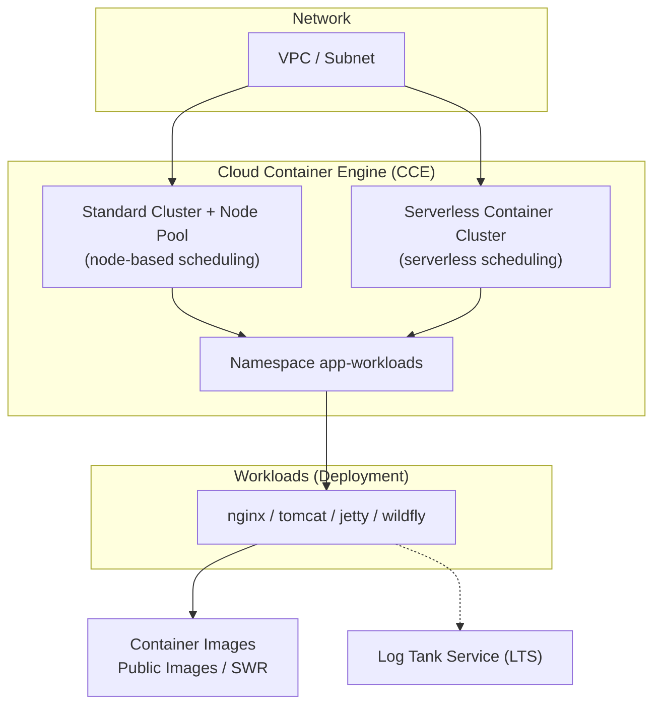

# Container Workloads Practices (CCE)


> A set of declarative workload definitions and infrastructure-as-code for running common containerized applications on Cloud Container Engine (CCE), covering scenarios such as web servers and Java application servers, enabling quick deployment and operation on managed container clusters.

## 2. Introduction / Overview

This practice runs common applications such as nginx, tomcat, jetty, and wildfly on Cloud Container Engine (CCE) as Kubernetes workloads (Deployments). Each application provides a declarative definition, accompanied by Terraform infrastructure-as-code for one-click creation of the cluster, node pool, and namespace. All 4 workloads above have been verified through real deployment on a CCE cluster in this account, with Pods reaching the Running state.

Intended audience: container platform teams, cloud migration engineers, and architecture reviewers.

## 3. Table of Contents

- [1. Title and Badges](#container-workloads-practices-cce)
- [2. Introduction / Overview](#2-introduction--overview)
- [3. Table of Contents](#3-table-of-contents)
- [4. Architecture Diagram](#4-architecture-diagram)
- [5. Highlights](#5-highlights)
- [6. Cloud Services Involved](#6-cloud-services-involved)
- [7. Prerequisites](#7-prerequisites)
- [8. Quick Start / One-Click Deployment](#8-quick-start--one-click-deployment)
- [9. Step-by-Step Deployment](#9-step-by-step-deployment)
- [10. Usage / Verification](#10-usage--verification)
- [11. Cleanup](#11-cleanup)
- [12. Detailed Description](#12-detailed-description)
- [13. Dependencies and Acknowledgments](#13-dependencies-and-acknowledgments)
- [14. FAQ / Troubleshooting](#14-faq--troubleshooting)
- [15. Contributing Guide](#15-contributing-guide)
- [16. License](#16-license)
- [17. Submitter](#17-submitter)

## 4. Architecture Diagram



## 5. Highlights

- **Declarative workloads**: Each application has one Deployment YAML with clearly editable parameters (image, ports, resources, logging, startup command).
- **Dual scheduling modes**: The same definition runs on both node-based clusters (node pool) and serverless container clusters, fully reusable without modification.
- **Infrastructure as code**: Terraform one-click creates the VPC, subnet, cluster, node pool, and namespace for consistent, reproducible environments.
- **Unified logging**: Workloads enable stdout/stderr log collection via Pod annotations, delivered to the Log Tank Service (LTS).
- **Verified and usable**: All 4 workloads have been deployed on a real CCE cluster and passed end-to-end verification (all Pods Running).

## 6. Cloud Services Involved

| Service | Purpose |
|---------|---------|
| Cloud Container Engine (CCE) | Container cluster and workload scheduling |
| Virtual Private Cloud (VPC) / Subnet | Private network for the cluster |
| Container Image Repository (SWR) | Image storage (public images usable directly; private images recommended here) |
| Log Tank Service (LTS) | Container log collection and search |

## 7. Prerequisites

- A cloud account with permissions to create CCE and VPC resources.
- Terraform 1.5+ and kubectl installed locally.
- Target region: `cn-north-4` (CN North-Beijing4).

## 8. Quick Start / One-Click Deployment

```bash
# 1. Create the cluster, node pool, and namespace (expected: validate passes, apply outputs cluster ID and namespace)
cd infra
terraform init
terraform validate
terraform apply

# 2. After configuring kubeconfig, deploy all workloads (expected: Pods reach Running state)
kubectl apply -f src/workloads/
```

## 9. Step-by-Step Deployment

```bash
# Step 1: Create infrastructure
cd infra
terraform init
terraform validate          # Expected: Success! The configuration is valid.
terraform apply             # Expected: creates VPC, subnet, CCE cluster, node pool, namespace

# Step 2: Obtain the cluster access credential (kubeconfig) and configure it locally

# Step 3: Deploy workloads
kubectl apply -f src/workloads/nginx-deployment.yaml
kubectl apply -f src/workloads/tomcat-deployment.yaml
kubectl apply -f src/workloads/jetty-deployment.yaml
kubectl apply -f src/workloads/wildfly-deployment.yaml

# Step 4: Verify
kubectl get pods -n app-workloads
```

## 10. Usage / Verification

```bash
# Check workload status (expected: all Pods in Running state)
kubectl get pods -n app-workloads
kubectl get svc -n app-workloads
```

Verification success criteria: all application Pods are in the Running state.

## 11. Cleanup

```bash
# Delete workloads
kubectl delete -f src/workloads/

# Destroy the cluster and network (run only after confirming no longer needed)
cd infra && terraform destroy
```

## 12. Detailed Description

### 12.1 Workload Inventory

| Application | Type | Ports | Resources (CPU / Memory) | Description |
|-------------|------|-------|--------------------------|-------------|
| nginx | Deployment | 80 | 0.25 vCPU / 256Mi | Web server |
| tomcat | Deployment | 8080 | 1 vCPU / 256Mi (2048Mi in node-pool mode) | Java application server |
| jetty | Deployment | 8080, 8443 | 0.5 vCPU / 1024Mi | Java application server |
| wildfly | Deployment | 8080, 9990 | 0.5 vCPU / 1024Mi | Java application server |

### 12.2 Scheduling Modes

The same workload definition can be scheduled onto two cluster modes:

- **Node-based cluster (node pool)**: Workloads run on Elastic Cloud Server nodes, suitable for stable, long-running loads.
- **Serverless container cluster**: Workloads run directly without node management, suitable for elastic scaling and short-lived tasks.

Switching scheduling modes only requires applying the workload to the target cluster; the definition content needs no changes.

### 12.3 Logging

All workloads enable stdout/stderr log collection via Pod annotations, delivered to the Log Tank Service (LTS), and can be searched in the LTS console by workload or container.

## 13. Dependencies and Acknowledgments

- Container images: public images for each application (nginx, tomcat, jetty, wildfly).
- Cluster management platform: Cloud Container Engine (CCE).
- Logging platform: Log Tank Service (LTS).

## 14. FAQ / Troubleshooting

- **Image pull failed?** When pulling public images is unstable, push the image to the Container Image Repository (SWR) and use the internal address.
- **Pod stuck in Pending?** Check whether the node-pool nodes are ready and whether resource requests exceed node capacity; serverless mode does not require node readiness.
- **Want to adjust resources?** Modify `resources.requests` / `resources.limits` in the corresponding YAML and re-run `kubectl apply`.

## 15. Contributing Guide

Issues and Pull Requests are welcome. When adding a new application, please provide the corresponding Deployment / StatefulSet YAML under `src/workloads/` and add a row to the inventory in section 12.1.

## 16. License

This project is released under the **MIT-0** license. See [LICENSE](./LICENSE) for details.

## 17. Submitter

- Submitter: zhangcheng123321
