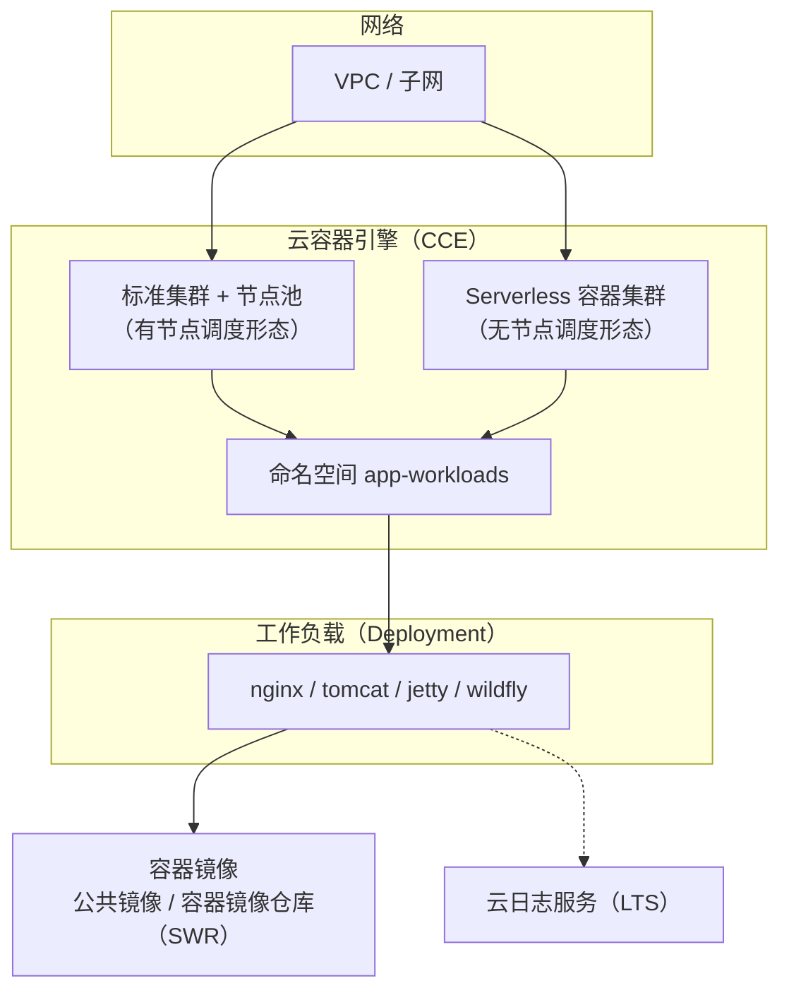

# 容器工作负载实践（CCE）


> 一组常见容器化应用在云容器引擎（CCE）上运行的声明式工作负载定义与基础设施即代码，覆盖 Web 服务器与 Java 应用服务器等场景，可快速在托管容器集群上部署运行。

## 2. 简介 / 概述

本实践将 nginx、tomcat、jetty、wildfly 等常用应用，以 Kubernetes 工作负载（Deployment）的形式在云容器引擎（CCE）上运行。每个应用提供一份声明式定义，并配套 Terraform 基础设施即代码用于一键创建集群、节点池与命名空间。上述 4 个工作负载均已在本账号 CCE 集群真实部署验证、Pod 进入 Running 状态。

适用对象：容器平台团队、应用上云工程师、架构评审委员。

## 3. 目录

- [1. 标题与徽章](#容器工作负载实践cce)
- [2. 简介 / 概述](#2-简介--概述)
- [3. 目录](#3-目录)
- [4. 架构图](#4-架构图)
- [5. 方案亮点](#5-方案亮点)
- [6. 涉及云服务](#6-涉及云服务)
- [7. 前置条件](#7-前置条件)
- [8. 快速开始 / 一键部署](#8-快速开始--一键部署)
- [9. 分步部署](#9-分步部署)
- [10. 使用方法 / 验证](#10-使用方法--验证)
- [11. 清理资源](#11-清理资源)
- [12. 详细说明](#12-详细说明)
- [13. 依赖与致谢](#13-依赖与致谢)
- [14. FAQ / 故障排除](#14-faq--故障排除)
- [15. 贡献指南](#15-贡献指南)
- [16. 许可证](#16-许可证)
- [17. 提交者](#17-提交者)

## 4. 架构图



## 5. 方案亮点

- **声明式工作负载**：每个应用一份 Deployment YAML，参数（镜像、端口、资源、日志、启动命令）清晰可改。
- **双调度形态**：同一份定义既可在有节点集群（节点池）运行，也可在无节点调度形态（Serverless 容器集群）运行，内容完全复用。
- **基础设施即代码**：Terraform 一键创建 VPC、子网、集群、节点池、命名空间，环境一致可复现。
- **统一日志**：工作负载通过 Pod 注解启用标准输出 / 错误日志采集，统一投递到云日志服务（LTS）。
- **已验证可用**：4 个工作负载均已在真实 CCE 集群部署并通过端到端验证（Pod 全部 Running）。

## 6. 涉及云服务

| 服务 | 用途 |
|------|------|
| 云容器引擎 CCE | 容器集群与工作负载调度 |
| 虚拟私有云 VPC / 子网 | 集群运行的私有网络 |
| 容器镜像仓库 SWR | 镜像存储（公共镜像可直接使用，私有镜像推荐存放于此） |
| 云日志服务 LTS | 容器日志采集与检索 |

## 7. 前置条件

- 云账号，具备 CCE、VPC 创建权限。
- 本地已安装 Terraform 1.5+ 与 kubectl。
- 目标区域：`cn-north-4`（华北-北京四）。

## 8. 快速开始 / 一键部署

```bash
# 1. 创建集群、节点池与命名空间（预期：validate 通过，apply 后输出集群 ID 与命名空间）
cd infra
terraform init
terraform validate
terraform apply

# 2. 配置 kubeconfig 后部署全部工作负载（预期：Pod 进入 Running 状态）
kubectl apply -f src/workloads/
```

## 9. 分步部署

```bash
# 步骤 1：创建基础设施
cd infra
terraform init
terraform validate          # 预期：Success! The configuration is valid.
terraform apply             # 预期：创建 VPC、子网、CCE 集群、节点池、命名空间

# 步骤 2：获取集群访问凭证（kubeconfig），配置到本地

# 步骤 3：部署工作负载
kubectl apply -f src/workloads/nginx-deployment.yaml
kubectl apply -f src/workloads/tomcat-deployment.yaml
kubectl apply -f src/workloads/jetty-deployment.yaml
kubectl apply -f src/workloads/wildfly-deployment.yaml

# 步骤 4：验证
kubectl get pods -n app-workloads
```

## 10. 使用方法 / 验证

```bash
# 查看工作负载状态（预期：各 Pod 处于 Running）
kubectl get pods -n app-workloads
kubectl get svc -n app-workloads
```

验证成功标志：所有应用 Pod 处于 Running。

## 11. 清理资源

```bash
# 删除工作负载
kubectl delete -f src/workloads/

# 销毁集群与网络（确认不再需要后执行）
cd infra && terraform destroy
```

## 12. 详细说明

### 12.1 工作负载清单

| 应用 | 类型 | 端口 | 资源（CPU / 内存） | 说明 |
|------|------|------|---------------------|------|
| nginx | Deployment | 80 | 0.25 核 / 256Mi | Web 服务器 |
| tomcat | Deployment | 8080 | 1 核 / 256Mi（节点池形态 2048Mi） | Java 应用服务器 |
| jetty | Deployment | 8080, 8443 | 0.5 核 / 1024Mi | Java 应用服务器 |
| wildfly | Deployment | 8080, 9990 | 0.5 核 / 1024Mi | Java 应用服务器 |

### 12.2 调度形态

同一份工作负载定义可调度到两种集群形态：

- **有节点集群（节点池）**：工作负载运行在弹性云服务器节点上，适合稳定负载。
- **无节点调度形态（Serverless 容器集群）**：工作负载直接运行、无需管理节点，适合弹性伸缩与短时任务。

切换调度形态只需将工作负载 apply 到对应集群，定义内容无需修改。

### 12.3 日志

所有工作负载在 Pod 注解中启用标准输出 / 错误日志采集，统一投递到云日志服务（LTS），可在日志服务控制台按工作负载 / 容器检索。

## 13. 依赖与致谢

- 容器镜像：各应用公共镜像（nginx、tomcat、jetty、wildfly）。
- 集群管理平台：云容器引擎（CCE）。
- 日志平台：云日志服务（LTS）。

## 14. FAQ / 故障排除

- **镜像拉取失败？** 公共镜像拉取不稳定时，将镜像推送至容器镜像仓库（SWR）并使用内网地址。
- **Pod 一直处于 Pending？** 检查节点池节点是否就绪、资源 requests 是否超出节点可用量；无节点调度形态无需关注节点就绪。
- **想调整资源？** 修改对应 YAML 的 `resources.requests` / `resources.limits` 后重新 `kubectl apply`。

## 15. 贡献指南

欢迎提交 Issue 与 Pull Request。新增应用时，请在 `src/workloads/` 下提供对应的 Deployment / StatefulSet YAML，并在第 12.1 节清单中补充一行。

## 16. 许可证

本项目基于 **MIT-0** 许可证发布。详见 [LICENSE](./LICENSE)。

## 17. 提交者

- 提交者：zhangcheng123321
