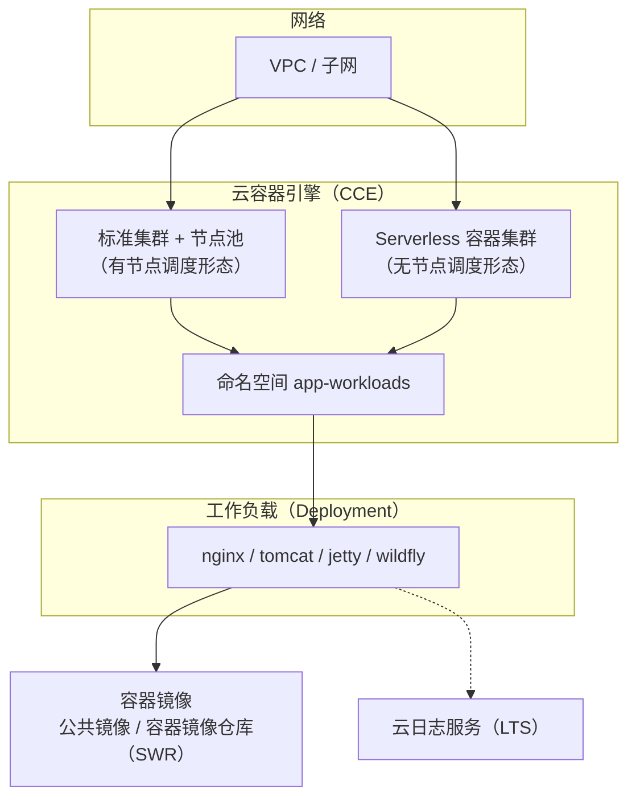

# 容器工作负载实践 · 架构说明

> 本实践将一组常见容器化应用（Web 服务器、Java 应用服务器等）以工作负载形式部署到云容器引擎（CCE），提供可复用的声明式工作负载定义与基础设施即代码。上述 4 个工作负载均已在本账号 CCE 集群真实部署验证、Pod 进入 Running 状态。

## 1. 架构总览

## 2. 组件说明

| 组件 | 用途 |
|------|------|
| VPC / 子网 | 集群运行的私有网络 |
| CCE 标准集群 + 节点池 | 有节点调度形态，适合长期稳定负载 |
| CCE Serverless 容器集群 | 无节点调度形态，适合弹性 / 短时负载 |
| 命名空间 app-workloads | 工作负载的逻辑隔离边界 |
| 工作负载（Deployment） | 声明式运行的容器应用 |
| 容器镜像仓库（SWR） | 推荐存放私有镜像（公共镜像可直接使用） |
| 云日志服务（LTS） | 采集并检索容器标准输出 / 错误日志 |

## 3. 工作负载清单

| 应用 | 类型 | 端口 | 资源（CPU / 内存） | 说明 |
|------|------|------|---------------------|------|
| nginx | Deployment | 80 | 0.25 核 / 256Mi | Web 服务器 |
| tomcat | Deployment | 8080 | 1 核 / 256Mi（节点池形态 2048Mi） | Java 应用服务器 |
| jetty | Deployment | 8080, 8443 | 0.5 核 / 1024Mi | Java 应用服务器 |
| wildfly | Deployment | 8080, 9990 | 0.5 核 / 1024Mi | Java 应用服务器 |

## 4. 调度形态说明

同一份工作负载定义可调度到两种集群形态：

- **有节点集群（节点池）**：工作负载运行在弹性云服务器节点上，适合稳定负载、需要自定义节点规格的场景。
- **无节点调度形态（Serverless 容器集群）**：工作负载直接运行、无需管理节点，适合弹性伸缩与短时任务。

两种形态的工作负载内容与配置完全一致，仅调度目标不同。

## 5. 日志

所有工作负载通过 Pod 注解启用标准输出 / 错误日志采集，统一投递到云日志服务（LTS），可在日志服务控制台按工作负载 / 容器检索。

## 6. 镜像来源

示例工作负载默认引用公共镜像以便零配置体验。生产环境建议将镜像推送至容器镜像仓库（SWR）并使用内网地址，以获得稳定的拉取速度与访问安全。
